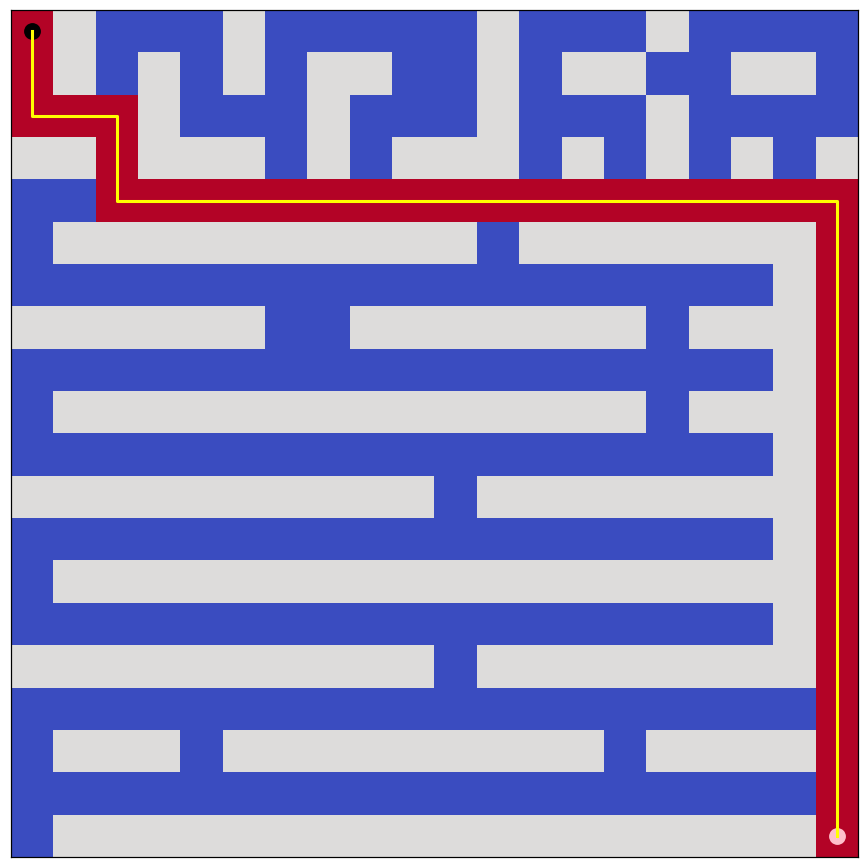
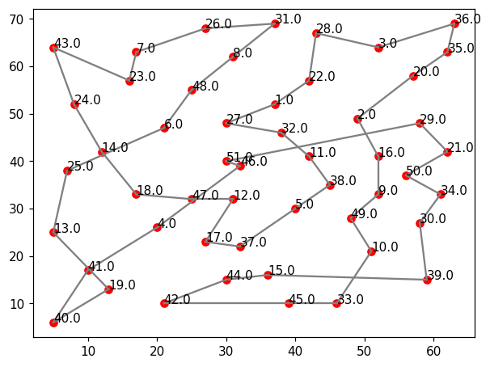

# Search and Optimization

An AI coursework project investigating how graph search and stochastic optimization behave on three problems: a grid maze, a nonconvex one-dimensional objective, and a 51-city traveling salesman problem.

**Implementation:** Behrad Mazaheri  
**Course:** Artificial Intelligence, Sharif University of Technology, Spring 2025  
**Assignment material:** The original notebook credits Sadegh Mohammadian. The maze, visualization helpers and fixed genetic algorithm experiment settings are supplied course components. This is a revised portfolio edition of the submitted implementations.

## Implemented methods

- DFS and BFS for maze traversal.
- A* with Manhattan distance, a priority queue and best-cost tracking.
- Strict hill climbing and a variant with random moves and retries.
- Bounded stochastic hill climbing with random restarts for `sin(3x) + 0.3x² - 0.7x`, on `[-2, 2]`.
- A genetic algorithm for closed TSP tours, using tournament selection, order-preserving prefix crossover, swap mutation and two-individual elitism.

## Run

Use **Python 3.11 or newer**. The recorded run used Python 3.12.14, NumPy 2.3.5 and Matplotlib 3.10.8.

From the repository root:

```bash
cd hw01-search-and-optimization
python -m venv .venv
source .venv/bin/activate
python -m pip install -r requirements.txt
python tools/run_notebook.py
python tools/verify.py
```

On Windows, activate the environment with `.venv\Scripts\activate`.

The Python runner executes all notebook code cells in order, captures text and Matplotlib outputs, and updates the notebook and `results/metrics.json`. It does not require a Jupyter installation. The included notebook already contains the resulting outputs.

For interactive use, open `search_and_optimization.ipynb` in a Jupyter-capable editor using the same Python environment, set the working directory to this folder and run all cells. `TSP51.txt` must remain alongside the notebook. An optional JupyterLab installation can be added with `python -m pip install jupyterlab`.

## Recorded results

### Maze search

| Algorithm | Moves | Expanded states | Reached goal |
| --- | ---: | ---: | --- |
| DFS | 112 | 205 | Yes |
| BFS | 38 | 161 | Yes |
| A* | 38 | 55 | Yes |
| Strict hill climbing | 27 | Not measured | No |

Moves count transitions between grid squares. Expansion counts include the goal. BFS and A* produced paths whose lengths equal the start-to-goal Manhattan lower bound of 38, confirming shortest paths for this maze.



A* expanded about 65.8% fewer states than BFS on this maze. This result depends on the maze and tie-breaking order; it is not a general performance guarantee.

Randomized hill climbing succeeded in **51 of 100 runs**, using seeds `0..99`, 20 attempts per run and random-move probability `0.2`. Strict hill climbing stopped at `(10, 17)`, before the goal `(19, 19)`.

### One-dimensional search

Each of ten runs uses ten attempts: the first starts at `0.4` and the remaining starts are sampled uniformly within the interval. Proposed points are clipped to the permitted bounds, and the best observed point is retained.

A 100,001-point grid reference found approximately `x = 1.54552`, `f(x) = -1.36240074`. The ten stochastic runs achieved objective values between approximately **-1.362341 and -1.361204**. This comparison is numerical; it does not certify global optimality.

### Traveling salesman problem

| Setting or result | Value |
| --- | ---: |
| Cities | 51 |
| Seed | 42 |
| Population size | 2,000 |
| Tournament size | 4 |
| Crossover probability | 0.9 |
| Swap-mutation probability | 0.1 |
| Generations | 200 |
| Initial best tour length | 1,332.172973 |
| Final best tour length | 518.524918 |
| Improvement over initial best | 61.08% |
| Target length | 450 |
| Target reached | No |



Distances are **unrounded Euclidean distances** and include the return to the first city. No optimality claim or comparison with rounded TSPLIB benchmark optima is made. The initial and final lengths above describe one seeded experiment, not an average over repeated GA runs.

The original notebook stored an unseeded run ending at 514.029143; this edition reports the new reproducible run instead. Exact stochastic results can depend on Python and dependency versions.

## Portfolio revisions

- Replaced DFS branch-local counters with a graph-search expansion count covering unsuccessful branches.
- Added A* best-cost tracking and parent-based path reconstruction.
- Enforced bounds and added actual random restarts to the one-dimensional search.
- Retained the best visited objective value even after later uphill moves.
- Added fixed seeds, analysis responses, a result summary and regression checks.
- Removed the student identifier and stale saved outputs before regenerating results.
- Retained attribution and preserved the supplied maze, plotting helpers and fixed GA experiment configuration.

## Verification

All **24 code cells** executed successfully in sequence with the supplied data. **Six regression checks** passed, covering route validity and shortest paths, unreachable goals and expansion accounting, identical start/goal states, bounded stochastic search, valid GA permutations and elitism, and seeded repeatability.

Inputs assume a rectangular maze with valid traversable start and goal coordinates. DFS, BFS and A* return an empty path if a valid goal is unreachable. The current DFS/BFS implementations carry paths in their frontier entries, favoring clarity over minimum memory use. Randomized methods do not guarantee optimal solutions.

## Files

- `search_and_optimization.ipynb`: revised notebook with executed outputs.
- `TSP51.txt`: supplied 51-city coordinates, unchanged.
- `requirements.txt`: recorded NumPy and Matplotlib versions.
- `tools/run_notebook.py`: sequential Python-cell execution and output capture.
- `tools/verify.py`: regression checks using the notebook's actual definitions.
- `results/metrics.json`: recorded experiment configuration and results.
- `results/figures/`: generated figures used in the notebook and README.
