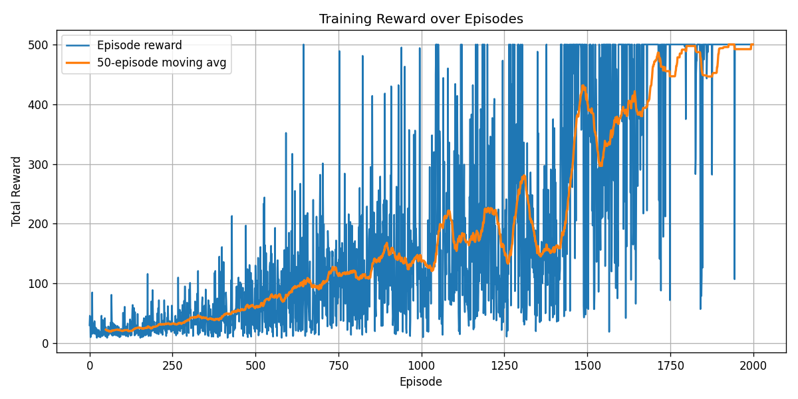

# HW02 — Adversarial Search, MDPs and Reinforcement Learning

Artificial Intelligence coursework, Sharif University of Technology, Spring 2025. Portfolio edition by **Behrad Mazaheri**.

## Scope

- Depth-limited **Minimax** and **Alpha-Beta pruning** for simplified Onitama.
- Analytic transition/reward tensors and **Value Iteration** for simplified Scotland Yard.
- Discretized **tabular Q-learning** on Gymnasium CartPole-v1.
- Every-visit Monte Carlo evaluation of the learned greedy policy.

## Run

Tested with Python 3.12. Create a virtual environment, then run from this folder:

```bash
python -m pip install -r requirements.txt
python tools/verify.py
python tools/execute_notebook.py
```

Alternatively, open `assignment.ipynb` in Jupyter or VS Code and run all cells. Install/register the environment's kernel if needed:

```bash
python -m ipykernel install --user --name python3
```

`algorithms.py` contains reusable definitions. `results/` records the executed edition's results. Rendering videos uses the provided Pillow CartPole renderer, while training and evaluation use **Gymnasium CartPole-v1**. These two environments have different failure-step rewards (0 versus 1); the optional video is illustrative and is not the benchmark evaluation.

The notebook uses 10,000 MDP validation episodes, 2,000 training episodes and 100 evaluation episodes. Increase validation episodes for a more precise transition estimate. Game demos are capped at 60 turns; reaching the cap is reported as a draw, not a proven game-theoretic draw.

## Recorded results

| Check / experiment | Result |
| --- | --- |
| Correctness checks | 12 passed |
| Minimax / Alpha-Beta, initial position at depth 3 | Same value and move |
| Transition row sums, including absorbing capture states | 1 |
| Sampled transition RMSE, nonterminal rows | 0.004178 |
| Reward error on observed transitions | 0 |
| Value Iteration Bellman residual | 8.13e-7 |
| Greedy CartPole evaluation, 100 held-out seeds (20000–20099) | Mean 500, SD 0, min/max 500 |
| Monte Carlo vs learned Q estimate RMSE, 112 visited states | 22.3981 |

All 22 code cells were executed sequentially with IPython in this preparation environment; a separate Jupyter kernel could not start here. The included Jupyter runner is provided for normal local use and was not executed here. See `results/verification.json`, `results/evaluation.json`, and the notebook outputs for evidence.



Evaluation reaches CartPole-v1's **500-step time limit** on this fixed seed set. This is a single training run, not a guarantee across all seeds or environments. `max_a Q(s,a)` is a learned value estimate, not a true state-value function. Monte Carlo uses horizon-capped returns without bootstrapping at truncation, while Q-learning bootstraps through time-limit truncation; this and approximation error can contribute to the reported RMSE. Unvisited states are excluded from the comparison.

## Revisions from the uploaded submission

- Implemented legal passes with card rotation; removed the random agent's fake `(0,0,0,0)` move.
- Added finite game caps and invalid-move checks.
- Made terminal wins/losses dominate material heuristics; added pass handling to both search agents.
- Made captured MDP states absorbing with zero future reward; vectorized Value Iteration and added a convergence guard.
- Sorted Mr. X's neighbor list for deterministic seeded sampling.
- Restricted initial epsilon to 1; seeded environment resets and exploratory action sampling.
- Ended training/evaluation/video episodes on `terminated OR truncated`; removed terminal bootstrapping while retaining truncation bootstrapping in Q-learning.
- Replaced the unqualified value-error norm with an RMSE on visited states and separate greedy-policy reward evaluation.
- Removed references to missing `OnitamaCards.jpg` and `ScotlandYard.jpg`, as well as the remote header logo. The environment renderers provide self-contained visualizations.
- Cleared old outputs and generated new outputs from the revised code.

## Attribution and provenance

The uploaded `main70.ipynb` identifies **Arman Tahmasebi Zadeh** as assignment author. Assignment prompts, card definitions, game/environment scaffolds and visualization helpers derive from that course material and are not claimed as original portfolio work. Filled-in Minimax, Alpha-Beta, MDP tensor construction, model validation, Value Iteration, Q-learning and direct-evaluation cells come from the uploaded submission. Their exact individual/group authorship is not independently verified.

This prepared edition adds the revisions above, verification scripts, seeded experiments and documentation. These revisions should not be represented as unchanged original coursework. No license is imposed on the course-provided material. Check course publication rules before publishing the solutions.

## Reference

[Gymnasium: Handling Time Limits](https://gymnasium.farama.org/tutorials/gymnasium_basics/handling_time_limits/) explains termination versus truncation and their effect on bootstrapping.
