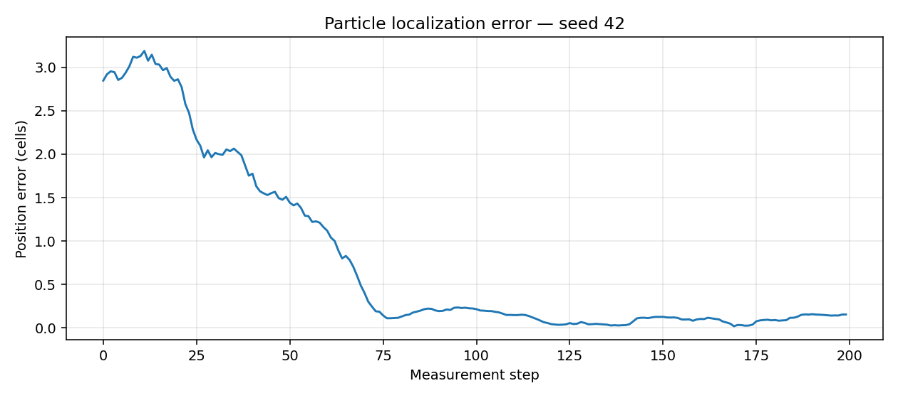
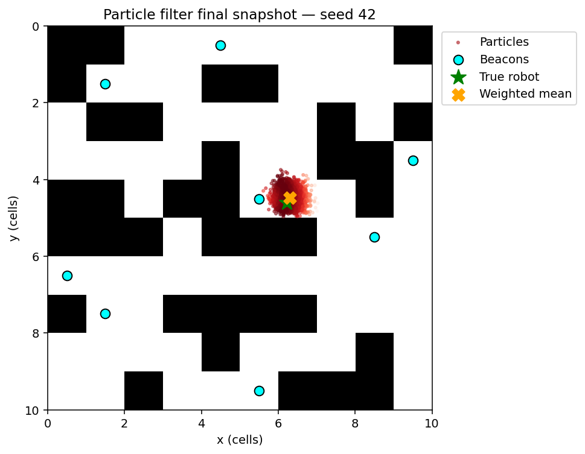

# HW03 — Probabilistic Models and Particle Filtering

AI coursework portfolio edition by **Behrad Mazaheri**. This assignment studies Bayesian networks, conditional independence, exact and approximate inference, and robot localization with a particle filter.

## Contents

- `assignment.ipynb`: revised notebook with newly executed outputs.
- `algorithms.py`: reusable submitted definitions and revised implementations.
- `maze.py`: new headless replacement for the missing `draw.py` dependency.
- `assets/original-network-diagram.png`: original embedded reference image.
- `results/`: exact inference, sampling comparisons, particle error history, plots and verification results.
- `tools/verify.py`: 16 correctness checks.

## Run

Tested with Python 3.12. From this assignment folder, preferably in a virtual environment:

```bash
python -m pip install -r requirements.txt
python tools/verify.py
python tools/execute_notebook.py
```

Or open the notebook in Jupyter / VS Code and run all cells. If the local environment's kernel is not registered:

```bash
python -m ipykernel install --user --name python3
```

All **19 code cells** were executed sequentially using IPython during preparation. The separate standard Jupyter runner is included for local use; it was not executed here because this environment could not start a separate kernel. The particle simulation runs a finite 200-step experiment instead of an infinite GUI loop.

## Model discrepancy: read before interpreting results

The original embedded diagram shows **binary Grade and Letter**. The uploaded code defines **three Grade states**, uses different Letter probabilities, and includes ambiguous High/Low comments. The diagram also appears to repeat a Grade row label. This edition preserves the submitted numerical CPDs and their evidence order (`Difficulty`, then `Intelligence`) exactly. State indices are used without claiming unsupported natural-language meanings. Results describe **the submitted code's model**, not a reconstruction of the diagram. No CPD values were silently changed to fit the image.

Edges are `Difficulty → Grade`, `Intelligence → Grade`, `Intelligence → SAT`, and `Grade → Letter`. Difficulty and Intelligence are d-separated without evidence but d-connected when Letter is observed, because conditioning on a descendant opens the Grade collider.

## Recorded Bayesian network results

| Quantity | State probabilities |
| --- | --- |
| Exact P(Grade) | [0.447000, 0.271400, 0.281600] |
| Forward sampling P(Grade), 10,000 draws | [0.437700, 0.274100, 0.288200] |
| Gibbs P(Grade), 10,000 retained draws after 1,000 burn-in | [0.462400, 0.267700, 0.269900] |
| Exact P(Intelligence given Letter=0) | [0.788134, 0.211866] |
| Likelihood weighting, 10,000 weighted draws | [0.793856, 0.206144] |
| Rejection sampling, 10,000 accepted draws | [0.787800, 0.212200] |

Seeds 42–45 are fixed for these experiments. Forward sampling is a convenient unconditional sampler for this DAG. Gibbs samples are correlated and the burn-in setting is illustrative, not a mixing guarantee. Rejection samples enforce the evidence; likelihood weighting clamps evidence and requires weighted counts. With only five variables, Variable Elimination is inexpensive and provides an exact reference. Both exact results were independently checked by exhaustive enumeration of all joint assignments.

The deterministic weighted min-fill order is `Difficulty, Letter, Grade, Intelligence, SAT`; ties use variable names. The induced graph retains original moral edges and adds fill edges, and agrees with pgmpy's reference implementation for this order. The original submitted implementation recorded only fill edges rather than the complete induced graph.

## Particle filter results and assumptions

The uploaded simulation could not import `draw.Maze`. The new `maze.py` provides continuous cell coordinates, traversable beacon cells, Euclidean distances to beacon centers and Matplotlib snapshots. These conventions were added here; the absent original module's geometry cannot be verified.

| Experiment: seed 42, 2,000 particles, 200 measurements | Result |
| --- | ---: |
| Initial weighted-mean position error | 2.8473 cells |
| Final weighted-mean position error | 0.1554 cells |
| Position RMSE over all measurements | 1.2752 cells |





This is **one seeded demonstration**, not a general localization guarantee. Orientation is assumed known; the particles receive the robot's heading, not its position. Sensor noise is the submitted uniform ±0.02, while the Gaussian likelihood kernel uses sigma=0.9, so weighting is an intentionally broad approximation rather than a matched sensor likelihood. Motion uses noisy forward steps and endpoint collision checks; this is a teaching simulation, not a physical robot model. Multimodal beacon-distance beliefs may yield a weighted mean in a wall or away from any mode. The 95% concentration flag is a heuristic, not a calibrated probability of correct localization.

## Corrections and additions

- Removed notebook-side package-install commands and redundant legacy imports.
- Preserved CPD numbers, clarified state indexing and documented the diagram mismatch.
- Corrected the induced graph to include original moral edges as well as fill edges.
- Actually ran forward, likelihood-weighted and rejection samplers; provided evidence, seeds and weighted estimates.
- Added exact posterior queries, a sampling comparison and the missing result explanations.
- Fixed `Robot.sense` indexing a scalar float as `[0]`.
- Installed the resampled particle population; the uploaded loop created `new_particles` but continued using old particles.
- Applied collision checks to particle motion and retained valid parents when jitter lands in a wall.
- Used the actual particle count and a radial distance in the confidence heuristic.
- Added bounded robot move attempts, explicit zero-weight sampler handling, seeded finite simulations and quantitative plots.

## Attribution

Course prompts, the reference image, CPD values, maze layout and particle/robot scaffold originate from `Updated_P3_Section6_Completed_Full.ipynb`. The upload does not identify a named assignment author or establish individual/group contributions, so this edition does not infer one. Library sampling and exact inference are **pgmpy implementations**, not from-scratch algorithms authored by the student.

The headless maze module, verification scripts, explanations, quantitative comparisons and correctness revisions were added during portfolio preparation. These must not be presented as unchanged original submission code. No license is imposed on the supplied course material.

## Documentation references

- [pgmpy sampling](https://pgmpy.org/api/generated/inference/pgmpy.sampling.BayesianModelSampling.html)
- [Discrete Bayesian networks](https://pgmpy.org/api/generated/models/pgmpy.models.DiscreteBayesianNetwork.html)
- [Exact inference and induced graphs](https://pgmpy.org/_modules/pgmpy/inference/ExactInference.html)
