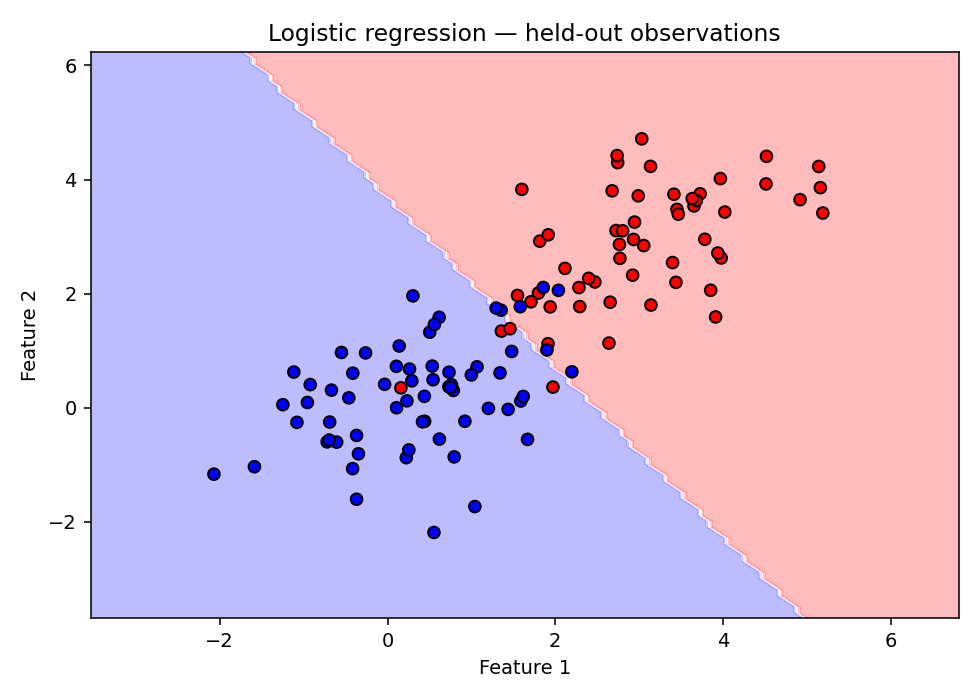
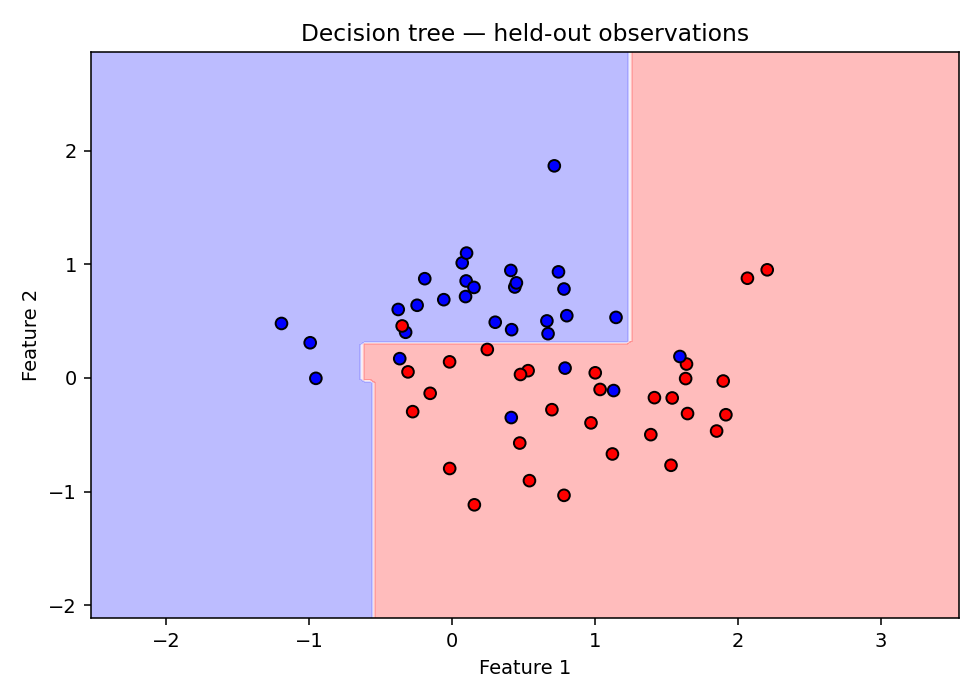

# HW05.1 — Classical Machine Learning from Scratch

AI coursework portfolio edition by **Behrad Mazaheri**. Linear regression, binary logistic regression and a Gini-based decision tree are implemented with NumPy rather than a modeling library. Matplotlib is used for plots.

The assignment number follows the uploaded filename `AI_S2025_PHW5.1_completed.ipynb`. This repository does not invent a missing HW04. The upload's introduction mentioned Gaussian Naive Bayes, but no implementation was included; it is excluded from this project's claims.

## Run

Tested with Python 3.12. From this folder, in a virtual environment:

```bash
python -m pip install -r requirements.txt
python tools/verify.py
python tools/execute_notebook.py
```

Alternatively open `assignment.ipynb` with Jupyter or VS Code and run all cells. Register the local kernel if needed:

```bash
python -m ipykernel install --user --name python3
```

NumPy and Matplotlib are the algorithm/demo dependencies; IPython and notebook tools support interactive execution. No scikit-learn, pandas, network download or external data file is needed. All nine code cells were run sequentially with IPython during preparation. The standard separate-kernel runner is provided for local use and was not executed in this restricted preparation environment.

## Algorithms and data

- **Linear regression:** full-MSE gradient descent; 200 one-feature observations with slope 4, intercept -1 and Gaussian noise of standard deviation 0.8. Train/test sizes: 160/40.
- **Logistic regression:** binary cross-entropy gradient, stable sigmoid, threshold 0.5; 600 observations from two Gaussian blobs. Train/test sizes: 480/120.
- **Decision tree:** exhaustive thresholds at observed feature values, weighted Gini splits, maximum depth 4; 300 noisy two-moons observations generated in NumPy. Train/test sizes: 240/60.

Each dataset has a reproducible shuffled 80/20 split with seed 42. The split is not stratified. Data generation uses the fixed seeds in the notebook. The new NumPy moons generator produces different samples from the uploaded scikit-learn generator, so old tree results are not directly comparable.

## Recorded results

| Model | Training results | Held-out test results |
| --- | --- | --- |
| Linear regression | MSE 0.6151; R² 0.8960 | MSE 0.5319; R² 0.9164 |
| Logistic regression | Accuracy 96.46%; precision 95.95%; recall 97.13% | Accuracy 91.67%; precision 89.66%; recall 92.86% |
| Decision tree | Accuracy 91.25% | Accuracy 90.00% |

Tree test confusion matrix, rows=true and columns=predicted, labels `[0,1]`: `[[25,5],[1,29]]`.





These synthetic-data results illustrate learning behavior in one seeded split, not real-world predictive performance. No test-driven hyperparameter search was performed. The decision tree implementation is intentionally simple and has no pruning, missing-value handling or categorical-feature support. Logistic regression supports only labels 0/1; tree labels can be noncontiguous.

## Revisions from the upload

- Removed the unimplemented Gaussian Naive Bayes claim from the coverage list.
- Replaced scikit-learn dataset generation and splitting with NumPy functions, fulfilling the library-free modeling workflow.
- Added held-out linear and logistic regression evaluation; the upload evaluated both only on the training data.
- Matched the linear-regression gradient to the stated full MSE loss with the factor of two. The uploaded update corresponded to half-MSE scaling.
- Made sigmoid stable for extreme logits, without overflow.
- Normalized target shapes to prevent accidental broadcasting in regression metrics and training.
- Defined constant-target R²: 1 for perfect predictions, 0 otherwise.
- Fixed confusion-matrix labels to include classes present only in predictions; explicit label order is supported.
- Added input checks, quantitative results, held-out boundary figures and 16 correctness checks.

Checks include agreement with NumPy least squares, extreme-logit stability, constant-target metrics, prediction-only classes, constant-feature trees, noncontiguous labels, and split completeness and alignment. See `results/verification.json` and `results/experiments.json`.

## Attribution

Model classes, original metric implementations and assignment prompts came from the supplied completed notebook. A course-template author and individual/group contribution details were not identified in the upload; this edition does not infer them. Correctness revisions, NumPy splitting/moons generation, verification scripts, new held-out experiments and documentation were added during portfolio preparation and should be distinguished from the original submission. No license is imposed on the supplied course material.

## Files

`assignment.ipynb` contains newly executed outputs. `algorithms.py` exposes reusable definitions without running experiments. `requirements.txt` records the tested dependencies; `tools/` provides checks and a local notebook runner; `results/` holds plots and machine-readable evidence.
