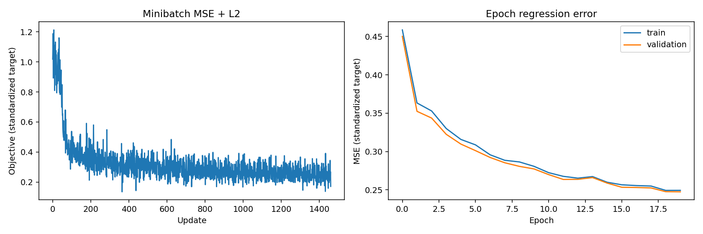
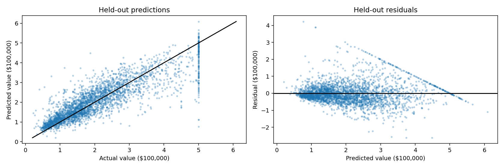

# HW05.2 — Multi-Layer Perceptron with NumPy

AI coursework portfolio edition by **Behrad Mazaheri**. A modular regression MLP implements affine layers, ReLU, backpropagation, MSE with L2 regularization and SGD with momentum using NumPy. Sigmoid forward/backward functions are implemented and checked independently; the trained network uses ReLU hidden layers and a linear output.

No autograd, PyTorch, torchvision or sklearn model is used. **Classification and softmax are not implemented**, despite generic wording in the uploaded class docstring.

## Run

Tested with Python 3.12. From this folder, in a virtual environment:

```bash
python -m pip install -r requirements.txt
python tools/verify.py
python tools/execute_notebook.py
```

Or open `assignment.ipynb` in Jupyter / VS Code and run all cells. Register the local environment's kernel if needed:

```bash
python -m ipykernel install --user --name python3
```

The dataset is bundled, so notebook execution does not require a network download. All **24 code cells** were run sequentially through IPython during preparation. The separate-kernel runner is supplied for local use and was not run in this preparation environment.

## Missing original utilities and provenance

The upload imports `utils.gradient_check`, `utils.data` and `utils.solver`, but none were provided. This edition adds `support.py` with independently written numerical-gradient helpers, data splitting/normalization and a minibatch Solver. They are **portfolio additions, not recovered original course code**. The original helper implementations and their split conventions cannot be verified.

Course prompts and implemented network primitives come from `AI_S2025_PHW5.2.ipynb`. It does not name a course-template author or establish individual/group contributions. Correctness revisions, replacement utilities, new training experiments and documentation must be distinguished from the original submission. No license is imposed on the supplied course material.

## Data and training

California Housing contains 20,640 rows and eight features. The target is median house value per census block group in units of $100,000, derived from 1990 census data. See `data/README.md` for acquisition and integrity.

- Split: 70% train (14,448), 15% validation (3,096), 15% test (3,096); shuffled seed 42.
- Feature and target mean/std are fitted on the **training split only**.
- Continuous target values are preserved; reported metrics undo target normalization.
- Architecture: `8 → 100 → 50 → 1`, hidden ReLU, linear output, float64.
- Initialization: normal weights with scale 0.05; zero biases; seed 42.
- Optimizer: momentum 0.9, initial learning rate 0.01, decay 0.95 each epoch, batch size 200, 20 epochs.
- Regularization: `0.5 * 1e-4 * sum(W²)` over weight matrices, no bias penalty.
- Best parameters are restored using the lowest **validation MSE**; test data is used only for final evaluation.

These fixed settings differ from the original five-epoch training block. No claim of globally optimal hyperparameters is made.

## Recorded metrics

Metrics are in original target units, without the regularization penalty. MSE has squared units of $100,000; MAE/RMSE have units of $100,000.

| Split/model | MSE | RMSE | MAE | R² |
| --- | ---: | ---: | ---: | ---: |
| Train MLP | 0.332860 | 0.576940 | 0.405581 | 0.750611 |
| Validation MLP | 0.330291 | 0.574710 | 0.408057 | 0.750168 |
| Test MLP | 0.349497 | 0.591183 | 0.410242 | 0.736317 |
| Test training-mean baseline | 1.326346 | 1.151671 | 0.909807 | -0.000682 |

The best-validation epoch was 20. These are results of **one fixed-seed random split**, not an evaluation on future data or geographically separated regions. Small floating-point differences can arise across numerical backends.



The minibatch plot includes the L2 penalty and varies with minibatch composition. Full-split epoch curves show plain standardized-target MSE. A growing gap would indicate overfitting; validation is used for checkpoint selection.



The diagonal represents perfect predictions. Residual structure and larger errors show where the model fails. Historical target values include an upper cap, and random geographic mixing can make this test easier than a spatial holdout. This teaching model is not a current housing-price estimator.

## Correctness checks and fixes

**25 checks passed**, including affine/activation finite differences, full-network gradients with and without L2, momentum behavior, leak-free normalization, continuous target preservation, learning a known linear function and restoring the best validation checkpoint. Full-network absolute gradient errors were below 2e-11 in the small float64 test. Original notebook numerical-gradient examples were executed too.

Changes from the upload:

- Removed dependency-install cells and unused future/pandas/torchvision imports.
- Added the missing utility replacements, bundled data and reproducible train/validation/test split.
- Made MSE shape-safe: no `squeeze`-induced scalar failures or accidental broadcasting; gradient divides by **all output elements** to match mean loss for multi-output regression.
- Stabilized sigmoid forward/backward against exponential overflow.
- Preserved float targets instead of converting housing values with `astype(int)`.
- Replaced classification-style `1 - accuracy` plots with regression MSE and held-out diagnostics.
- Documented regression-only scope; supplied parameter/normalization checkpoint.

## Files

- `network.py`: submitted neural-network primitives with correctness revisions.
- `support.py`: new replacement helpers and regression Solver.
- `assignment.ipynb`: executed notebook.
- `results/experiments.json`, `verification.json`, `training_history.json`: numerical evidence.
- `results/model_checkpoint.npz`: selected parameters plus feature/target normalization statistics. Instantiate the documented architecture and assign arrays `W1,b1,W2,b2,W3,b3` to `model.params` for reuse.
- `tools/`: verification and notebook runner.
